<h1 style="color: skyblue;">axelmultimedialv4</h1>

<h2>Tabla de contenidos</h2>

<ol>
  <li><a href="#pagina-web">1. Página Web</a></li>
  <li><a href="#ejercicios-touchdesigner">2. Ejercicios TouchDesigner</a></li>
  <li><a href="#experimentacion-de-proyecto">3. Experimentación de Proyecto</a></li>
</ol>

<h3 id="pagina-web" style="color: skyblue;">1. Página Web</h3>

<h4 style="color: skyblue;">Creación inicial</h4>

1. Creación de página HTML básica con un título y color de fondo. Yo aproveché de añadir un hypertexto que pudiera redireccionar a una página con una imagen, esto ya que relacione el concepto de "Multimedial" con la palabra "Interatividad".


<h4 style="color: skyblue;">Trabajo en clase</h4>

En su mayoría avances en clase en base a las actividades que se iban presentando. Como ya había hecho otras páginas dentro del mismo código, no tuve que implementar muchas cosas.


<h4 style="color: skyblue;">Portafolio Web</h4>

<details>
<summary><strong>Código index.html</strong></summary>

```html
<!DOCTYPE html>
<html lang="es">
<head>
  <meta charset="UTF-8">
  <title>Multimedial Axel</title>
  <link rel="icon" href="img/futuro.jpeg" type="image/jpeg">
  <style>
    body {
      margin: 0;
      background-color: #9765a3;
      font-family: "Courier New", monospace;
    }

    .container {
      display: flex;
      height: 100vh;
    }

    .sidebar {
      width: 200px;
      background-color: rgba(219, 190, 227, 0.6);
      padding: 50px;
      display: flex;
      flex-direction: column;
      gap: 20px;
    }
  </style>
</head>
<body>
  <div class="container">
    <div class="sidebar">
      <a href="obra.html">Obra</a>
      <a href="galería.html">Galería</a>
      <a href="contacto.html">Contacto</a>
    </div>

    <div class="main">
      <div class="bloque">
        <h1>MULTIMEDIAL</h1>
        <p class="nombre"><strong>Axel Fernández</strong></p>
        <p class="sub"><strong>Artista visual</strong></p>
      </div>
    </div>
  </div>
</body>
</html>
```

</details>

<details>
<summary><strong>Código obra.html</strong></summary>

```html
<!DOCTYPE html>
<html lang="es">
<head>
  <meta charset="UTF-8">
  <title>Statement</title>
  <link rel="icon" href="img/futuro.jpeg" type="image/jpeg">
  <style>
    body {
      margin: 0;
      background-color: #86d199;
      font-family: "Courier New", monospace;
    }

    .container {
      display: flex;
      min-height: 100vh;
    }

    .sidebar {
      width: 200px;
      background-color: rgba(219, 190, 227, 0.6);
      padding: 50px;
      display: flex;
      flex-direction: column;
      gap: 20px;
    }
  </style>
</head>
<body>
  <div class="container">
    <div class="sidebar">
      <a href="index.html">Volver</a>
    </div>

    <div class="main">
      <div class="bloque">
        <h1>STATEMENT</h1>
        <p>
          Mi obra aborda un testimonio de mi desarrollo en la cultura de internet
          y cómo la gente de mi generación interactúa con esta misma.
        </p>
      </div>
    </div>
  </div>
</body>
</html>
```

</details>

<details>
<summary><strong>Código galería.html</strong></summary>

```html
<!DOCTYPE html>
<html lang="es">
<head>
  <meta charset="UTF-8">
  <title>Galería</title>
  <style>
    body {
      margin: 0;
      background-color: #77b8ba;
      font-family: "Courier New", monospace;
    }

    .thread-grid {
      display: grid;
      grid-template-columns: repeat(auto-fit, minmax(200px, 1fr));
      gap: 1.5rem;
      padding: 1rem;
    }

    .thread-box img {
      width: 100%;
      max-height: 300px;
      object-fit: contain;
    }
  </style>
</head>
<body>
  <div class="container">
    <div class="sidebar">
      <a href="index.html">Volver</a>
    </div>

    <div class="main">
      <h1>GALERÍA</h1>
      <div class="thread-grid">
        <div class="thread-box">
          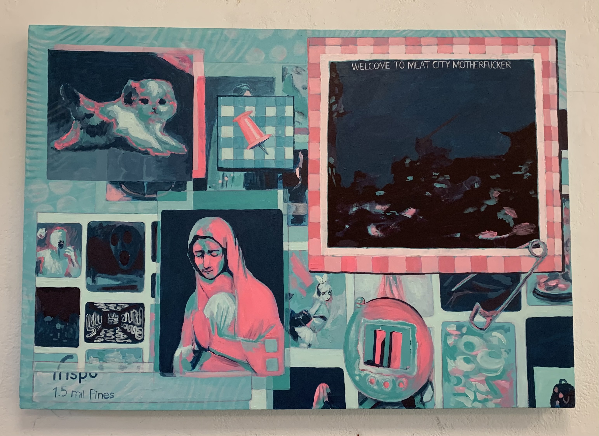
          <p>"Guardar?" (2026)</p>
        </div>
        <div class="thread-box">
          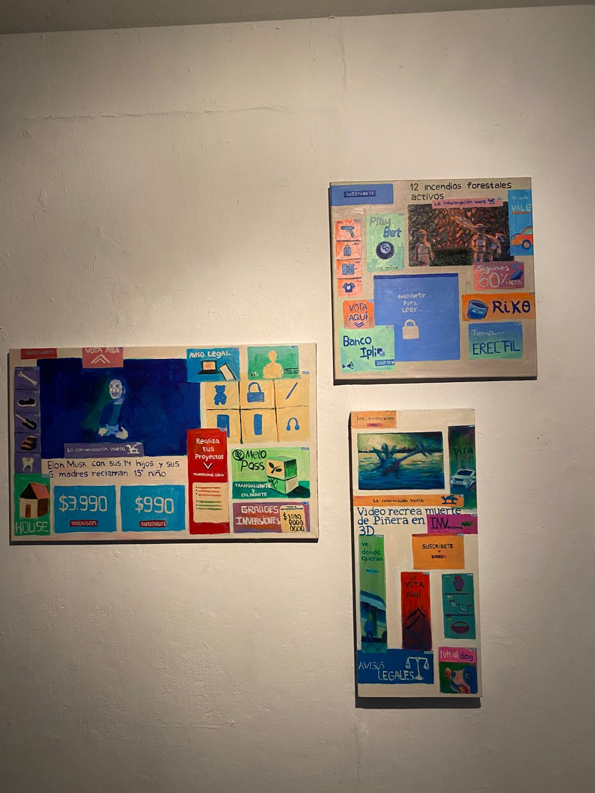
          <p>"990911_67420.zip" (2025)</p>
        </div>
        <div class="thread-box">
          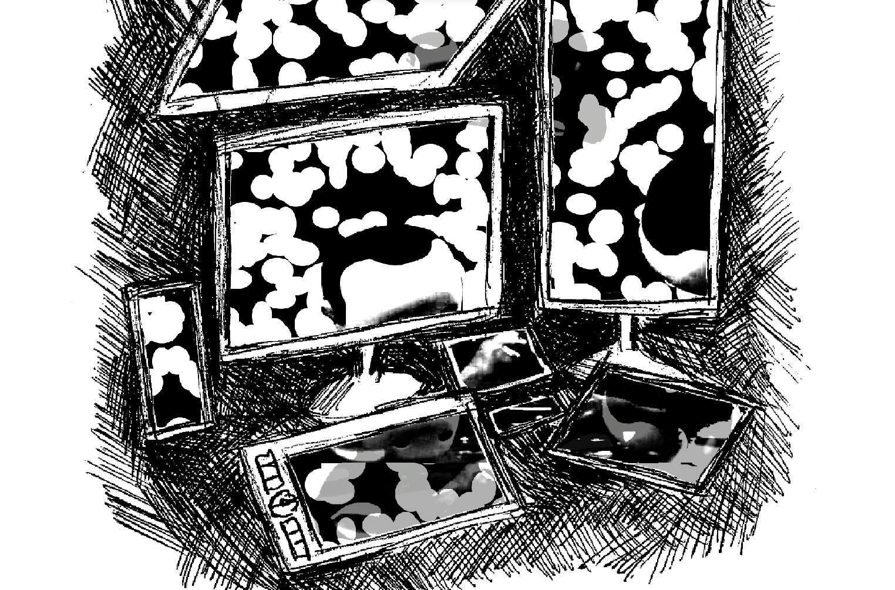
          <p>"Crónicamente en líneas" (2025)</p>
        </div>
      </div>
    </div>
  </div>
</body>
</html>
```

</details>

<details>
<summary><strong>Código contacto.html</strong></summary>

```html
<!DOCTYPE html>
<html lang="es">
<head>
  <meta charset="UTF-8">
  <title>Contacto</title>
  <style>
    .foto {
      width: 180px;
      height: 180px;
      border-radius: 50%;
      object-fit: cover;
      border: 2px solid #dbbee3;
    }

    .links {
      display: flex;
      flex-direction: column;
      gap: 15px;
    }
  </style>
</head>
<body>
  <div class="container">
    <div class="sidebar">
      <a href="index.html">Volver</a>
    </div>

    <div class="main">
      <h1>CONTACTO</h1>
      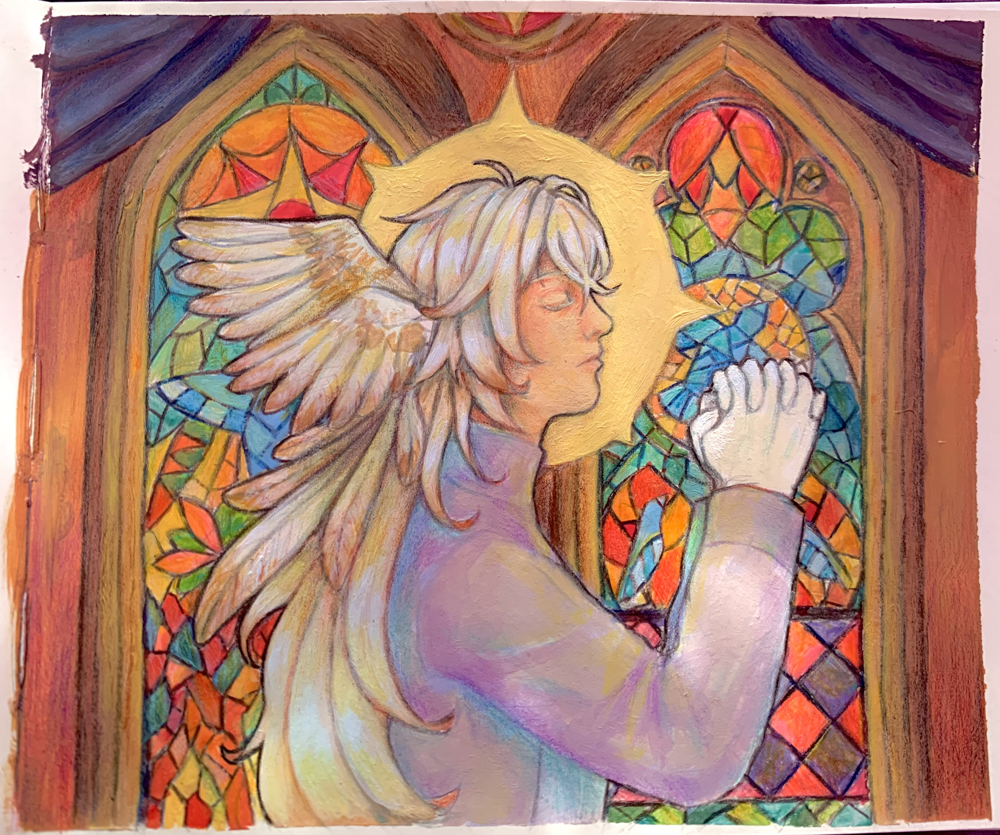

      <div class="links">
        <a href="https://instagram.com/mraxelblue" target="_blank">Instagram</a>
        <a href="mailto:amfeern@gmail.com">Correo</a>
      </div>
    </div>
  </div>
</body>
</html>
```

</details>

<details>
<summary><strong>Código perro.html</strong></summary>

```html
<!DOCTYPE html>
<html lang="es">
<head>
  <meta charset="UTF-8">
  <meta name="viewport" content="width=device-width, initial-scale=1.0">
  <title>me perdí</title>
  <link rel="icon" href="img/icono.png" type="img/png">
  <style>
    body {
      margin: 0;
      background-color: rgb(151, 38, 189);
      display: flex;
      height: 100vh;
    }

    img {
      max-width: 100%;
      margin-left: 50px;
      margin-top: 200px;
    }

    .sidebar a {
      color: #390333;
      text-decoration: none;
      margin-top: 500px;
    }
  </style>
</head>
<body>
  <div class="img">
    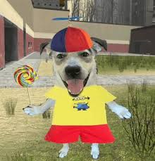
  </div>

  <div class="sidebar">
    <a href="index.html">Volver</a>
  </div>
</body>
</html>
```

</details>

<h3 id="ejercicios-touchdesigner" style="color: skyblue;">2. Ejercicios TouchDesigner</h3>

<p><a href="https://drive.google.com/drive/folders/11rVqjtPkH4bHHtFGG_YI67GkcPrHDOVK?dmr=1&amp;ec=wgc-drive-%5Bmodule%5D-goto">Aquí estan todos los ejercicios realizados en Touck Designer durante el semestre</a></p>

<div style="display: flex; flex-direction: column; align-items: center; gap: 16px;">
  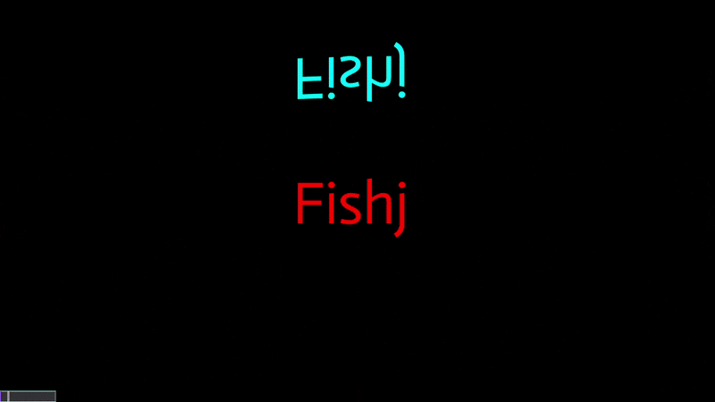
  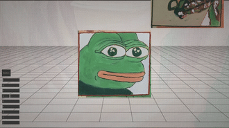
  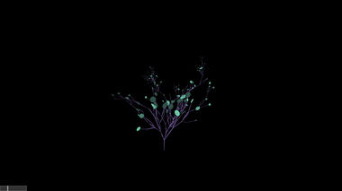
  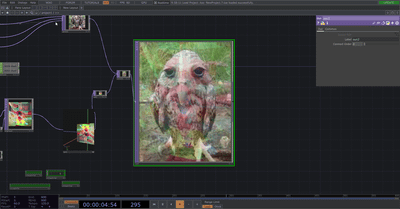
  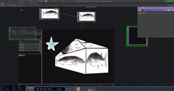
</div>

<h3 id="experimentacion-de-proyecto" style="color: skyblue;">3. Experimentación de Proyecto</h3>

<h4 style="color: skyblue;">Resumen de la obra</h4>

La obra consiste de un vídeo montaje que utiliza imágenes de obras anteriores y capturas de internet con el propósito de crear una serie de imágenes de naturaleza abstracta que aluden al tema principal. Este vídeo se va a realizar en base a capturas del programa Touchdesigner, en el cual las imágenes fueron modificadas para conseguir efectos que no se pueden conseguir en la edición de vídeo. Además, se crearon imágenes con IA para tener una variedad de fondos más amplia, en conjunto a capturas de pantalla provenientes del sitio web original en el que se inspira la obra. Finalmente, se espera que esta obra sea presentada en un proyecto común.

<h4 style="color: skyblue;">Propuesta conceptual:</h4>

Mi propuesta consiste en la reutilización de imágenes de una obra previa para crear un videomontaje que aluda al sitio web 4chan. En un inicio tenía una narrativa más definida, pero finalmente decidí inclinarme a una resolución más abstracta, que coincidiera con mis materiales (mis reproducciones en pintura) y un audio simple que lograra crear un ambiente digital simple. Este proyecto explora el concepto del humor y la incomodidad al mismo tiempo sin ser extremadamente literal, usando a los personajes icónicos de la página aludida y referencia de su interfaz y funcionamiento. El propósito de esta obra es más exploratorio que definitivo, y es una prueba de una temática que me gustaría seguir extendiendo. Los fondos más simples le añaden un carácter más ambiguo al espacio en el que se presentan los personajes del vídeo, lo cual se exploró con diferentes variaciones de colores y formas.

<h4 style="color: skyblue;">Propuesta de montaje</h4>

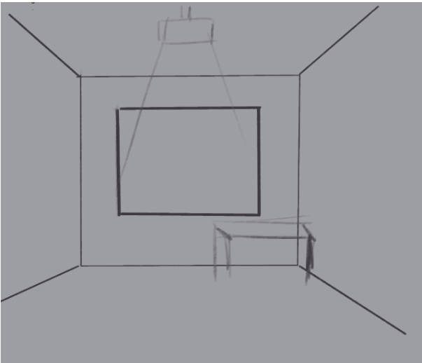

<h4 style="color: skyblue;">Maqueta de proyecto</h4>


<h3 style="color: skyblue;">4. Referencias y recursos</h3>

3. En base a páginas realizadas anteriormente (https://aseeel-ctrl.github.io/teeth/index.html, https://aseeel-ctrl.github.io/vocachan/) busqué partes en esos códigos que me pudieran servir para organizar en cajas/grids y poner la columna lateral. Le pregunte a google como poner una foto con transparencia en el fondo de manera estática.

He usado inteligencia artificial para arreglar el Grid de la galería e insertar los link en el apartado de "contacto".


