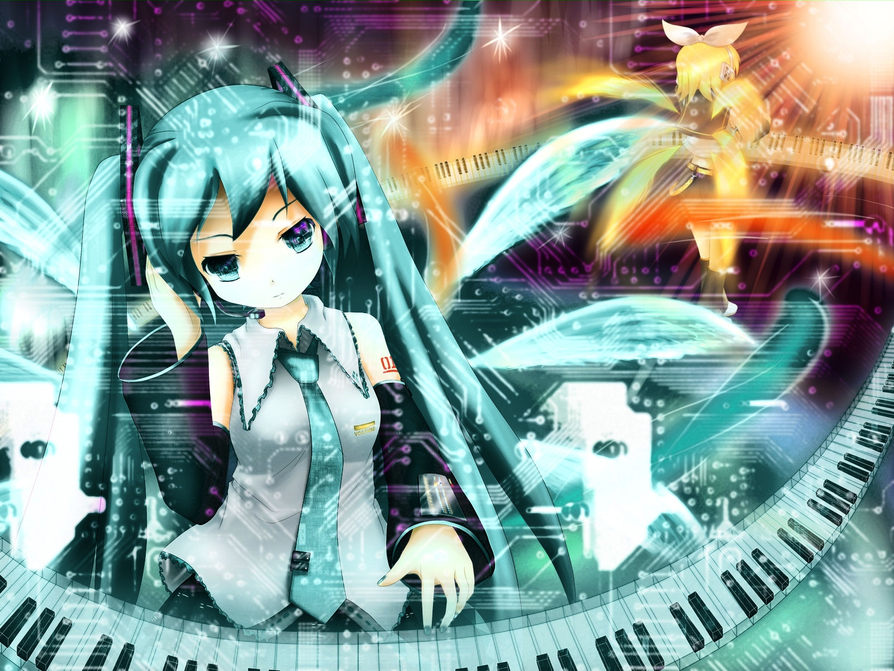
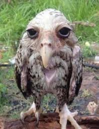

<h1 style="color: skyblue;">axelmultimedialv4</h1>

<h3 style="color: skyblue;">Creación inicial</h3>

1. Creación de página HTML básica con un título y color de fondo. Yo aproveché de añadir un hypertexto que pudiera redireccionar a una página con una imagen, esto ya que relacione el concepto de "Multimedial" con la palabra "Interatividad".

<h3 style="color: skyblue;">Trabajo en clase</h3>

2. En su mayoría avances en clase en base a las actividades que se iban presentando. Como ya había hecho otras páginas dentro del mismo código, no tuve que implementar muchas cosas.

<h3 style="color: skyblue;">Referencias y recursos</h3>

3. En base a páginas realizadas anteriormente (https://aseeel-ctrl.github.io/teeth/index.html, https://aseeel-ctrl.github.io/vocachan/) busqué partes en esos códigos que me pudieran servir para organizar en cajas/grids y poner la columna lateral. Le pregunte a google como poner una foto con transparencia en el fondo de manera estática.

He usado inteligencia artificial para arreglar el Grid de la galería e insertar los link en el apartado de "contacto".

<h3 style="color: skyblue;">Touch Designer</h3>

<a href="https://drive.google.com/drive/folders/11rVqjtPkH4bHHtFGG_YI67GkcPrHDOVK?dmr=1&amp;ec=wgc-drive-%5Bmodule%5D-goto">Aquí estan todos los ejercicios realizados en Touck Designer durante el semestre</a>

